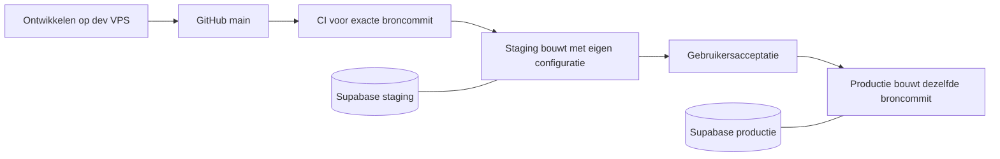

# DG Webservices uitrolprocedure

Versie 1.0 — 11 november 2026. Eigenaar: DG Webservices.

Deze procedure beschrijft hoe DG Webservices een applicatie ontwikkelt op een dev-VPS, aansluit op GitHub en Supabase, installeert op een doel-VPS en daarna beheerst uitrolt naar staging en productie. Danny regelt eigendom, budget en toegang; de worker voert de geautoriseerde inrichting, controles en releases uit. Vul voor ieder project het [projectintakeformulier](dg-webservices-projectintake.md) in.

De referentie is de native Dartflow-uitrol met Caddy en systemd. De procedure wordt per nieuw project toegepast. Bestaande DG-projecten kunnen een ander releasecontract hebben; hun omzetting is een afzonderlijke wijziging. De Dartflow-installatiescripts bevatten vaste projectwaarden en zijn geen algemene VPS-installer.

## De vaste releaseketen



De dev-VPS bevat ontwikkelcode en synthetische testdata. GitHub bewaart de broncode, migraties, workflows en technische documentatie. De doel-VPS bouwt iedere omgeving afzonderlijk en draait alleen de geactiveerde releases. Supabase staging en productie hebben ieder een eigen database, Auth-configuratie en sleutels.

Een release wordt geïdentificeerd door de volledige broncommit van 40 tekens, een release-ID en een configuratie-ID. De geaccepteerde stagingcommit gaat naar productie. De twee builds kunnen verschillen doordat hun publieke configuratie verschilt. Een latere documentatiecommit op `main` verandert de al actieve applicatie niet.

Staging en productie kunnen op dezelfde doel-VPS draaien, zoals bij Dartflow. Ze delen dan capaciteit en het risico van een hoststoring. Leg bij de intake vast of dat past bij de beschikbaarheidseis of dat productie een eigen VPS krijgt.

## Wie doet wat

| Onderdeel | Danny of aangewezen eigenaar | Worker |
| --- | --- | --- |
| Projectafspraken | Project, eigenaar, domeinen, budget en uitrolbevoegdheid vaststellen | Bestaande afspraken en inrichting controleren; projectprofiel aanvullen |
| VPS | Server bestellen of bestaande host aanwijzen; providerconsole beschikbaar houden | Inventariseren, voorbereiden en projectonderdelen installeren |
| GitHub | Repository en vereiste account-/apprechten beschikbaar stellen | Workflows, environments, configuratie en runners inrichten binnen die bevoegdheid |
| Supabase | Organisatie, regio en abonnement kiezen; toegang tot beide projecten regelen | Projecttoegang verifiëren; schema, beperkte rollen en applicatieconfiguratie inrichten |
| DNS en mail | Domeinbeheer en mail-/Google-provider beschikbaar stellen | Records, TLS, callbacks en bezorging controleren; geautoriseerde wijzigingen uitvoeren |
| SSH | Eenmalige bootstrap via console of bestaand beheeraccount mogelijk maken | Eigen sleutel voorbereiden, toegang testen en de server verder beheren |
| Acceptatie | Testpersonen en gewenste werking vaststellen; productie vrijgeven volgens projectafspraak | Staging uitrollen, gebruikersflows controleren, productie uitrollen en bewijs opleveren |
| Beheer | Hersteltijden, bewaartermijnen en onderhoudsverantwoordelijke vaststellen | Back-ups, monitoring, toegang en updates uitvoeren en controleren binnen de afgesproken scope |

Leg vooraf vast of de opdracht alleen staging omvat of ook productie na acceptatie. Een al verleende bevoegdheid blijft geldig binnen die scope. Nieuwe betaalde diensten, werkzaamheden aan andere projecten en destructieve datahandelingen vragen een eigen besluit wanneer ze buiten de opdracht vallen.

## 1 Projectgegevens vastleggen

Registreer de repository-URL, integratiebranch, dev-VPS, doelhost, staging- en productieorigin, contactpersoon en toegestane werkzaamheden. Noteer ook de beheerde locaties van geheimen, het back-upbeleid en wie de gebruikersacceptatie uitvoert.

De worker controleert bestaande repository-instructies, ongewijzigde lokale bestanden en reeds actieve toepassingen op de doelhost. Daarna legt hij per omgeving de accounts, diensten, vrije loopbackpoort, releasepaden, toolchain en backendprojectreferentie vast. Poorten en namen worden uit de hostinventaris gekozen; Dartflows poorten 4174 en 4175 zijn geen vrije standaardpoorten voor volgende projecten.

**Gereed wanneer:** de doelrepository, doelhost, twee origins, eigenaren en bevoegdheden ondubbelzinnig zijn vastgelegd. Onbekende waarden blijven herkenbaar open in de intake.

## 2 Ontwikkelen op de dev VPS

De worker maakt of gebruikt een checkout op de dev-VPS en werkt op een projectbranch, bijvoorbeeld `codex/<onderwerp>`. Bestaande lokale wijzigingen worden behouden. Voor parallel werk kan een eigen Git-worktree worden gebruikt.

Leg de runtime en pakketmanager met hun versies vast en commit de lockfile. Documenteer de opdrachten voor starten, migreren, lokale fixtures, controles en productiebuild. Gebruik een lokale ontwikkelbackend of een afzonderlijk developmentproject; staging en productie zijn geen resetbare ontwikkelomgeving.

Bewaar lokale geheimen in genegeerde, beperkt leesbare bestanden. Een `.env.example` beschrijft alleen namen en veilige voorbeeldwaarden. Productiedata wordt alleen na een afzonderlijke afspraak en passende anonimisering voor ontwikkeling gebruikt.

Iedere functionele wijziging krijgt de passende controles: types, lint, relevante tests en een productiebuild. Databasewijzigingen krijgen versiebeheer en worden lokaal beproefd. De worker beoordeelt of de oude applicatie nog blijft werken met het nieuwe schema, zodat herstel naar de vorige release mogelijk blijft.

**Gereed wanneer:** een nieuwe checkout met de vastgelegde toolchain reproduceerbaar start en de relevante controles slagen.

## 3 Supabase organiseren en projecten kiezen

Gebruik als DG-standaard een organisatie onder het juiste beheer en twee projecten per applicatie: `<project>-staging` en `<project>-production`. Twee aparte Supabase-beheerlogins zijn daarvoor niet nodig. Supabase beschrijft deze scheiding ook in zijn [procedure voor meerdere omgevingen](https://supabase.com/docs/guides/deployment/managing-environments).

Deze identiteiten hebben verschillende functies:

| Identiteit | Functie |
| --- | --- |
| Supabase-beheeraccount en organisatie | Eigendom, facturatie en beheertoegang |
| Staging- en productieproject | Afzonderlijke database, Auth, sleutels en providerinstellingen |
| Applicatiegebruiker in Supabase Auth | Persoon die op de website inlogt |
| Databasegebruiker voor de applicatie | Beperkte serververbinding voor applicatiegegevens |
| Databasebeheerder voor migraties | Afzonderlijke bevoegdheid om het schema te wijzigen |

Danny kiest organisatie, regio en abonnement en maakt de projecten aan, of machtigt de worker om dit met een afgesproken budget te doen. Voor een bestaande applicatie worden de bestaande projecten eerst gecontroleerd en waar passend hergebruikt; een nieuwe VPS vereist op zichzelf geen nieuwe Supabase-projecten. Registreer per project de naam, projectreferentie, regio, URL, publishable key en de verwijzing naar de beheerde databasecredentials. Beveilig beheeraccounts met MFA en houd een herstelmogelijkheid beschikbaar.

Verbind de benodigde Supabase-beheeraccount met de werkomgeving. De worker controleert via de beschikbare tools dat beide exacte projectreferenties toegankelijk zijn. Een connectorlabel zoals `DartFlow` bewijst die toegang niet. Als een pas gekoppelde account nog niet zichtbaar is, wordt eerst de toolverbinding of een verse werksessie gecontroleerd.

De browser mag de publishable key gebruiken. Een secret API-key of `service_role` heeft verhoogde bevoegdheden en hoort uitsluitend in een passende serverfunctie. Plaats deze nooit in een frontendvariabele. Zie [Supabase API keys](https://supabase.com/docs/guides/getting-started/api-keys).

**Gereed wanneer:** beide projecten beschikbaar zijn en de worker hun identiteit en daadwerkelijke beheertoegang heeft bevestigd.

## 4 Database en login per omgeving inrichten

De worker past de beoordeelde migraties eerst op staging toe. Productie krijgt dezelfde migraties via het afgesproken beheerpad. Beheercredentials worden niet aan de normale applicatie of buildcode gegeven. Na invoering van migraties worden schemawijzigingen consequent in die historie vastgelegd. Zie [database migrations](https://supabase.com/docs/guides/deployment/database-migrations).

Gebruik een beperkte runtime-databaserol. Bepaal per applicatie welke tabellen via een serververbinding of via Supabase Data API worden gebruikt. Richt grants en Row Level Security daarop in. Dartflow gebruikt private tabellen achter servercode; dat model mag niet zonder beoordeling worden gekopieerd naar een applicatie die rechtstreeks vanuit de browser tabellen benadert.

Controleer de werkelijke databaseverbinding vanaf de doel-VPS, inclusief certificaat- en hostnaamcontrole. Kies een bereikbare direct- of poolerverbinding uit het juiste project. Controleer IPv6-bereikbaarheid en de eisen aan pooling voor de gebruikte driver. Benodigde publieke CA-certificaten komen uit een gecontroleerde officiële bron; TLS-controle blijft ingeschakeld.

Voor Auth wordt per omgeving vastgelegd:

1. De eigen **Site URL**, bijvoorbeeld `https://staging.example.com` of `https://example.com`.
2. De exacte toegestane applicatiecallback, bijvoorbeeld `/auth/callback`, als die route daadwerkelijk in de app bestaat.
3. De toegestane aanmeldmethoden, inschrijvingsregels en testgebruikers.
4. Een eigen SMTP-configuratie als e-mail voor login, uitnodigingen of herstel wordt gebruikt.
5. De Google OAuth-configuratie als Google-login onderdeel van het product is.

Bij Google zijn er twee routes: Google stuurt terug naar `https://<project-ref>.supabase.co/auth/v1/callback`; Supabase stuurt daarna terug naar de applicatiecallback. Gebruik bij voorkeur een afzonderlijke OAuth-client per omgeving. Registreer de applicatie-origin en de door Supabase opgegeven providercallback op de juiste plaatsen bij Google. Zie [Google login](https://supabase.com/docs/guides/auth/social-sign-in/auth-google) en [Redirect URLs](https://supabase.com/docs/guides/auth/redirect-urls).

Richt voor productie-e-mail eigen SMTP in, inclusief afzender, passende SPF/DKIM/DMARC-records en een bezorgtest met een afgesproken ontvanger. De ingebouwde maildienst is beperkt en bedoeld voor ontwikkeling; zie [custom SMTP](https://supabase.com/docs/guides/auth/auth-smtp). SMTP- en OAuth-geheimen blijven in Supabase/providerbeheer en de beheerde kluis.

Maak de afgesproken testgebruikers aan of nodig hen uit. Koppel hun Auth-identiteit aan de juiste applicatierollen of organisatie. Een bereikbaar Auth-endpoint bewijst nog geen werkende login of toegangscontrole.

**Gereed wanneer:** databasebereikbaarheid, migraties, minimale rechten en de afgesproken loginmethoden met echte testaccounts zijn gecontroleerd.

## 5 SSH beheertoegang voor de worker geven

SSH-toegang, GitHub-toegang en Supabase-toegang worden afzonderlijk geregeld. De verbinding komt vanaf de machine waarop de worker zijn tools uitvoert. Bij vervanging van die machine worden sleutelopslag, netwerktoegang en bronbeperking opnieuw ingericht.

### Eenmalig door Danny en de worker

1. Danny levert de doelhost en een herstelpad via de providerconsole of een bestaand beheeraccount. De worker levert zijn publieke Ed25519-sleutel, fingerprint en toegestane bronadres. De privésleutel blijft in beschermde opslag op de worker, buiten Git.
2. Controleer de SSH-hostfingerprint via een al vertrouwd kanaal. Via de providerconsole kan deze worden opgevraagd met `ssh-keygen -lf /etc/ssh/ssh_host_ed25519_key.pub`. `ssh-keyscan` verzamelt een sleutel; de vergelijking met het vertrouwde kanaal bevestigt de identiteit.
3. Maak een eigen beheeraccount voor de worker, bijvoorbeeld `codex-dg-admin`. Vergrendel wachtwoordlogin en installeer uitsluitend de publieke sleutel. De homemap en `.ssh` krijgen passende eigenaar/rechten; `.ssh` is 0700 en `authorized_keys` is 0600.
4. Beperk de sleutel tot de afgesproken workerbron en een exact vervaltijdstip van één kalenderjaar. Gebruik UTC in de sleuteloptie en registreer ook de Nederlandse weergave. Controleer dat het account niet eerder vervalt.
5. Geef de voor deze beheertaak geautoriseerde sudo-rechten. Algemeen VPS-beheer met wachtwoordloze root-sudo geeft volledige controle over de host. Leg dat bereik vast; applicatie-, build- en runneraccounts krijgen die beheerbevoegdheid niet. Valideer sudoers met `visudo -c`.
6. De worker test een nieuwe SSH-sessie, de hostnaam, zijn identiteit en de noodzakelijke `sudo -n`-toegang. Pas na deze controle wordt overbodige tijdelijke bootstraptoegang ingetrokken.

Een sleutelregel volgt dit patroon; de worker maakt de echte regel met gecontroleerde waarden:

```text
from="<worker-bron-IP>",expiry-time="<YYYYMMDDhhmmssZ>",restrict ssh-ed25519 <publieke-sleutel> <beheerlabel>
```

`restrict` sluit onder meer PTY en forwarding uit; opdrachten via SSH blijven mogelijk. De sleutelvervaldatum verhindert nieuwe aanmeldingen na dat tijdstip. Bij intrekken moeten ook bestaande sessies en eventueel gestarte beheerprocessen worden beoordeeld. Zie het [OpenSSH authorized_keys-formaat](https://man.openbsd.org/sshd.8#AUTHORIZED_KEYS_FILE_FORMAT).

Gebruik in de clientconfiguratie een vaste hostalias, de eigen sleutel, `IdentitiesOnly yes`, `BatchMode yes`, `StrictHostKeyChecking yes` en geen agent- of poortforwarding. Voor het gewone OpenSSH-pad via Tailscale moeten zowel de netwerkregels als de SSH-sleutelcontrole toegang toestaan. Houd TCP 22 beperkt tot het afgesproken beheernetwerk; HTTP/HTTPS volgen de publicatiebehoefte.

**Gereed wanneer:** een verse verbinding en sudo werken, de hostkey is bevestigd en eigenaar, bron, fingerprint, afloop en intrekprocedure geregistreerd zijn. Plan een controle 30 dagen vóór afloop. Verlenging is een bewuste wijziging.

## 6 De doel VPS voorbereiden

Op een nieuwe VPS installeert de worker de afgesproken ondersteunde Linux-versie, beveiligingsupdates, tijdsynchronisatie, beheernetwerk en de projecttoolchain. Gebruik een passende, gepinde runtime en pakketmanager. Voor deze native route komen Caddy en systemd erbij. Een ander applicatietype krijgt een beoordeeld eigen service- en buildcontract.

Op een bestaande VPS begint de worker met een inventaris van diensten, sites, poorten, accounts, capaciteit en huidige healthidentiteiten. Bestaande toepassingen krijgen een controle vóór en na de inrichting. Hostwijzigingen worden eerst op conflicten en herstelbaarheid beoordeeld.

Richt vervolgens in:

- Firewall en netwerktoegang voor beheer, publiek HTTPS en noodzakelijke uitgaande verbindingen naar GitHub, pakketregisters en de gekozen backend.
- DNS voor staging, productie en eventuele `www`. Controleer alle autoritatieve nameservers en zowel A als AAAA. Een oud AAAA-record kan verkeer naar een andere server sturen.
- Caddy met eigen sitefragmenten en upstreams op loopback. Valideer de volledige configuratie vóór het herladen en behoud bestaande sites.
- Beperkte toegang tot de Caddy-beheerinterface. Controleer bereikbaarheid vanuit onbetrouwbare build- en appaccounts; alleen bestandsrechten zijn daarvoor onvoldoende.
- Logrotatie, capaciteitssignalering, uptime-/readinesscontrole, certificaatbewaking en de afgesproken back-ups.
- Een herstelpad via de providerconsole en gecontroleerde opstartafhankelijkheden na een reboot.

**Gereed wanneer:** de host bereikbaar is, DNS naar de juiste host wijst, TLS werkt, capaciteit voldoende is en bestaande toepassingen hun identiteit en werking behouden.

## 7 Per project staging en productie installeren

Gebruik per omgeving drie afzonderlijke identiteiten: een runneraccount dat de deployopdracht ontvangt, een buildaccount dat broncode bouwt en een appaccount dat de runtime uitvoert. Reserveer eigen diensten, poorten en paden. Een deploymentrunner wordt niet gebruikt voor algemene CI of voor onbetrouwbare pull-requestcode.

Het native contract bestaat uit:

| Onderdeel | Vereiste werking |
| --- | --- |
| Deploybroker | Root-beheerde, beperkte ingang met vaste repository, omgeving, diensten en paden; valideert argumenten en eigen bestanden |
| Broncontrole | Verifieert onafhankelijk de toegestane branchhistorie en de nieuwste verplichte geslaagde CI voor de exacte kandidaatcommit |
| Bronverwerving | Haalt de vaste repository en exacte commit op; controleert het archief vóór verwerking |
| Build | Draait zonder root onder het buildaccount, met begrensde resources en uitsluitend benodigde publieke buildvariabelen |
| Runtime | Draait onder het appaccount; buildcode en runners krijgen geen runtimegeheimen |
| Releaseopslag | Verzegelde, door root beheerde applicatiebestanden en vastgelegde artifactdigest |
| Configuratie | Onveranderbare bundel met eigen ID, root-only geheimen en gecontroleerde publieke waarden |
| Activatie | Eén atomische verwijzing schakelt de applicatierelease en bijbehorende configuratie om |
| Wederzijdse uitsluiting | Gedeelde hostbuildlock en eigen activatielock; overeengekomen gedrag bij overlap, helperdood en cleanup |
| Herstel | Een gezonde vorige app/configcombinatie wordt bij activatiefalen gecontroleerd hersteld; eerste uitrol zonder voorganger heeft een eigen foutpad |

Geef runners alleen de sudo-opdracht die bij hun broker hoort. Houd registratiecredentials en kortlevende GitHub-tokens buiten build- en appomgevingen. Controleer onder meer rechten, symlinks, negatieve toegangstests, resourcegrenzen en achterblijvende processen op de echte host.

Een lock mag niet vrijkomen terwijl de bijbehorende build of activatie nog kan doorlopen. Beproef het gekozen mechanisme met tijdelijke proefdiensten. Bij een onzekere cleanup blijft de omgeving voor nieuwe releases geblokkeerd tot gericht beheerdersherstel. Verwijder een lockbestand niet als manier om een actieve lock te omzeilen.

De Dartflow-renderers en installers leggen deze grenzen voor Dartflow vast. Voor een volgend project moeten de vaste waarden worden aangepast en de resulterende inrichting worden beoordeeld en gecontroleerd. Een generiek projectmanifest of centrale provisioningtool kan dit later versnellen.

**Gereed wanneer:** beide omgevingen hun eigen beperkte contract hebben, grenscontroles slagen en het installatiebewijs is opgeslagen.

## 8 GitHub aansluiten en variabelen plaatsen

Danny zorgt dat de worker toegang heeft tot de juiste repository en de benodigde instellingen. De worker configureert `staging` en `production`, eigen deployworkflows en dedicated runners met vaste labels. Repositoryrunners registreren vereist passende beheertoegang; de registratie gebruikt een kortlevend token. Zie [runners toevoegen](https://docs.github.com/en/actions/how-tos/manage-runners/self-hosted-runners/add-runners).

Laat CI op GitHub-hosted runners draaien. De doel-VPS-runners voeren uitsluitend de vertrouwde deployworkflow uit. Pin externe Actions op volledige commits en beperk `GITHUB_TOKEN` tot de benodigde rechten. De broker controleert de releasevoorwaarden onafhankelijk van de runner. Zie [veilig gebruik van GitHub Actions](https://docs.github.com/en/actions/reference/security/secure-use).

Stel beschikbare branchregels, vereiste CI en productiebeveiliging in volgens de projectafspraak. Controleer de daadwerkelijk opgeslagen regels: de beschikbaarheid verschilt per abonnement en repositoryzichtbaarheid. Een environmentnaam alleen dwingt geen goedkeuring af. Zie [GitHub environments](https://docs.github.com/en/actions/how-tos/deploy/configure-and-manage-deployments/manage-environments).

### Waar configuratie en geheimen horen

| Gegeven | Beheerde locatie |
| --- | --- |
| Applicatie-origin, Supabase-URL, publishable key, publieke buildkeuzes | GitHub environment Variables en gecontroleerde publieke hostconfiguratie |
| Runtime-databasecredential en andere servergeheimen | Beperkt leesbare hostconfiguratie of afgesproken secret store |
| Schema-/migratiebevoegdheid | Afzonderlijk beheerpad; alleen tijdens de geautoriseerde migratie |
| Google OAuth-secret en SMTP-credential voor Supabase Auth | Supabase/providerinstellingen en beheerde kluis |
| SSH-privésleutel van de worker | Beschermde workeropslag buiten Git en buiten de applicatie |
| Runnerregistratietoken | Alleen tijdens registratie; geen permanent projectgeheim |
| Automatisch `GITHUB_TOKEN` | Alleen tijdens de workflow, met minimale rechten |

Leg voor ieder project een exacte lijst met variabelen, geheimen en hun locatie vast. Gebruik de echte variabelenamen van die applicatie. Bij Dartflows huidige native route zijn geen zelf aan te maken GitHub-secrets nodig; andere integraties kunnen wel eigen secrets vereisen.

GitHub Variables wijzigen de root-only hostconfiguratie niet automatisch. De worker controleert de overeenstemming en maakt bij wijzigingen een nieuwe hostbundel en configuratie-ID. Publieke waarden die in frontendcode worden ingebouwd vereisen een nieuwe build. Hergebruik een configuratie-ID niet voor gewijzigde inhoud.

**Gereed wanneer:** runners online zijn, workflows de bedoelde omgeving selecteren, rechten en regels gecontroleerd zijn en de configuratielijst exact overeenkomt met het hostcontract.

## 9 Staging uitrollen en accepteren

1. Integreer de gereedstaande wijziging op de afgesproken branch. Wacht op de volledige verplichte CI voor de gekozen broncommit; een oudere groene run geldt niet als een nieuwere verplichte run mislukt of nog loopt.
2. Controleer migratieplan, compatibiliteit en het benodigde herstelpunt. Voer geautoriseerde migraties via het beheerpad uit. Lokale reset- en seedopdrachten horen niet bij deze hosted uitrol.
3. Start de stagingworkflow met de volledige bron-SHA en de gecontroleerde configuratie-ID. Wacht op de afgeronde workflow én hostverificatie. Een geaccepteerde dispatch bewijst alleen dat de opdracht is ontvangen.
4. Controleer via loopback en publieke HTTPS de actieve bron-SHA, release-ID, configuratie-ID en backendidentiteit. Controleer zowel health als readiness.
5. Test vanaf de gewone domeinnaam de gebruikersflows: aanmelden, afmelden, sessievernieuwing, juiste rollen, verboden toegang, belangrijkste gegevensactie en herladen. Test ook benodigde uploads, achtergrondtaken, mail en fout-/retrygedrag.
6. Controleer browserconsole, relevante schermformaten en de afgesproken apparaten. Bevestig dat staging uitsluitend stagingdiensten gebruikt en geen lokale testlogin publiek aanbiedt.
7. Leg resultaat, bewijs en open punten vast. De eigenaar accepteert de functionaliteit volgens de projectafspraak.

Gebruik bij DNSproblemen ook de autoritatieve antwoorden en het daadwerkelijk aangesproken serveradres. Een HTTP 200 met een oude website telt niet als een geslaagde releasecontrole. Een gerichte controle op het nieuwe adres is nuttig bewijs; normale DNS-resolutie moet afzonderlijk kloppen.

**Gereed wanneer:** de bedoelde release technisch gezond is én de afgesproken gebruikersacceptatie is afgerond.

## 10 Productie uitrollen

De worker controleert of productie binnen de verleende opdracht valt en staging voor dezelfde kandidaatcommit is geaccepteerd. Bij een opdracht die alleen staging omvat, wordt de concrete geaccepteerde release met bewijs ter vrijgave aangeboden.

Controleer vóór productie het actuele herstelpunt, de afgesproken herstelprocedure en eventuele migraties. Voer schemawijzigingen zo uit dat de actieve en vorige applicatieversie bruikbaar blijven, bijvoorbeeld door eerst velden toe te voegen en oude velden pas in een latere release te verwijderen.

Start daarna de productieworkflow met **dezelfde bron-SHA als staging** en de eigen productieconfiguratie. Productie bouwt opnieuw met haar eigen publieke waarden. De workflow en broker controleren de vereiste CI en de gezonde stagingidentiteit. De worker controleert na activatie HTTPS, readiness, bron/config/release, login, beperkte smokeacties, achtergrondtaken en overige sites op dezelfde host. Productietests gebruiken afgesproken accounts en gegevens.

Bewaar de vorige gezonde release en de bijbehorende configuratie zolang die voor herstel nodig zijn. Registreer de workflow-URL, uitgerolde bron-SHA, release-ID, configuratie-ID, artifactdigest, migratieversie, testresultaat en resterende punten zonder geheimen of persoonlijke testgegevens.

**Gereed wanneer:** de verwachte productieversie actief en gecontroleerd is en de eigenaar het opleverrapport heeft.

## 11 Fouten en herstel afhandelen

Bij een mislukte release onderzoekt de worker eerst de fout en de actieve toestand. Alleen een expliciet herkend lockconflict mag volgens het contract beperkt opnieuw worden geprobeerd. Andere fouten worden beoordeeld voordat een nieuwe activatie start.

Een approllback activeert een bekende gezonde eerdere release met haar eigen configuratie en controleert opnieuw readiness en publieke werking. Een gewone approllback zet de database, Storage, Auth-providerinstellingen of Edge Functions niet terug. Daarvoor bestaat een afzonderlijke herstelprocedure. Verwijderde gegevens kunnen niet met een oudere appbuild worden teruggehaald.

Bij een vastgelopen build of guardian wordt eerst vastgesteld welke processen en diensten nog actief zijn. Beëindig uitsluitend de betrokken eenheden volgens het herstelcontract. Controleer pas daarna dat locks vrij zijn en andere sites gezond blijven. Gebruik het providerherstelpad wanneer normale SSH-toegang ontbreekt.

De eerste oplevering omvat een gecontroleerde hersteloefening op staging. Een herstelhandeling die productiegegevens overschrijft of buiten de geautoriseerde scope valt, krijgt vooraf een concrete beoordeling en machtiging.

## 12 Backups en dagelijks beheer

Leg vóór operationele productieacceptatie vast hoeveel gegevensverlies acceptabel is (**RPO**) en hoe snel herstel moet lukken (**RTO**). Kies daarop frequentie, bewaartermijn, externe opslag, versleuteling, toegang en controle. Meet de hersteltijd in een geïsoleerde oefening.

Een databaseback-up omvat niet automatisch alle projectonderdelen. Supabase-back-ups bevatten geen Storage-objectbestanden; wachtwoorden van zelfgemaakte databaserollen worden evenmin in de dagelijkse back-ups/downloads bewaard. Neem bestanden, benodigde rolcredentials en serverconfiguratie afzonderlijk op. De beschikbare dagelijkse back-ups en PITR hangen af van het gekozen abonnement; voor projecten zonder passende beheerde back-upvoorziening worden eigen exports en externe opslag geregeld. Zie [Supabase back-ups](https://supabase.com/docs/guides/platform/backups).

| Moment | Werkzaamheden |
| --- | --- |
| Iedere release | CI, exacte bron/config, migratiecompatibiliteit, bereikbaarheid, readiness, relevante gebruikerscontrole en bewijs |
| Doorlopend | Signalen voor onbereikbaarheid, fouten, capaciteit, certificaten en mislukte back-ups; aangewezen ontvanger opvolgen |
| Periodiek onderhoud | OS, runtime, pakketmanager, dependencies, Caddy en runner op ondersteuning/beveiliging beoordelen; wijzigingen eerst controleren op staging |
| Volgens herstelbeleid | Back-ups controleren en herstel oefenen; uitkomst en gemeten RPO/RTO vastleggen |
| Na hostwijzigingen | Diensten, runners, guards en bestaande sites opnieuw controleren; reboot in een afgesproken onderhoudsvenster beproeven |
| 30 dagen vóór SSH-afloop | Toegangsbehoefte, workerbron, sleutel en vervaldatum beoordelen; zo nodig sleutel vervangen en opnieuw testen |
| Bij overdracht of beëindiging | SSH-/sudo-/netwerktoegang, GitHub/Supabase-toegang en ongebruikte credentials gericht intrekken; inventaris bijwerken |

Pin versies voor reproduceerbaarheid en plan updates zolang die versies ondersteund zijn. Controleer bij een Supabase CLI-upgrade het actuele gedrag en de projectgerichte `--help`; CLI v3 heeft het standaarddoel en de bevestiging voor hosted wijzigingen veranderd. Zie de [CLI v3-wijzigingen](https://supabase.com/changelog/supabase-cli-v3).

## Opleveren en de volgende uitrol versnellen

Bewaar bij ieder project het ingevulde intakeformulier, host-/releasecontract, configuratielijst, toegangsinventaris, releasebewijs, gebruikersacceptatie en herstelprocedure. Geheime waarden blijven in de daarvoor bestemde opslag; de documentatie bevat verwijzingen.

Rapporteer drie afzonderlijke uitkomsten:

- **Infrastructuur en release gecontroleerd:** juiste host, isolatie, build, actieve SHA/config, TLS, health en readiness.
- **Functioneel geaccepteerd:** echte login en afgesproken gebruikersflows met de juiste rollen en providers uitgevoerd.
- **Operationeel geaccepteerd:** herstel, back-ups, monitoring, opstartgedrag en verantwoordelijkheden gecontroleerd; uitzonderingen expliciet vastgelegd.

Voor een nieuwe applicatie op een bestaande host worden de hostvoorzieningen opnieuw gecontroleerd en de projectonderdelen toegevoegd. Een geheel nieuwe host doorloopt ook de eenmalige basisinrichting. Daarna bestaat een gewone release uit ontwikkelen, CI, staging, acceptatie en productie; accounts, DNS en runners worden alleen bij relevante wijzigingen aangepast.

Het intakeformulier en de startopdracht maken deze werkwijze herhaalbaar. Volledige automatische provisioning vraagt daarnaast om een generiek, beoordeeld projectmanifest en installers. De huidige Dartflow-scripts en de fixture-first onderdelen van DG Ops Control vormen daarvoor referenties; ze zijn geen al uitgerolde algemene provisioningdienst.

## Dartflow als concrete referentie

De actuele technische details staan in [deployment.md](deployment.md), de beheerverbinding in [ssh-management.md](ssh-management.md) en het uitrolbewijs in [het v15-opleverrapport](../voorbeelden/opleverrapport-v15.md). De eerste uitrol van de voorafgaande app is bewaard in [het historische acceptatierapport](../voorbeelden/release-acceptatie.md).

Op 11 november 2026 zijn `staging.dartflow.nl` en `dartflow.nl` op `dg-nxttrack-01` uit broncommit `4634852c17cc7737bec246c0b48310e975a36920` gebouwd en geactiveerd. Het algemene beheeraccount is `codex-dg-admin`; zijn sleutel vervalt op 11 november 2027 om 09:28:54 UTC, oftewel 10:28:54 Nederlandse tijd.

Vanaf de huidige worker kan de bestaande beheerverbinding zo worden gecontroleerd:

```sh
ssh -F /home/codex/.ssh/dg-nxttrack-admin.conf dg-nxttrack-01-admin 'hostname; id; sudo -n id'
```

Ieder Dartflow GitHub-environment heeft deze vier **Variables**:

| Naam | Staging | Productie |
| --- | --- | --- |
| `DARTFLOW_APP_ORIGIN` | `https://staging.dartflow.nl` | `https://dartflow.nl` |
| `DARTFLOW_DATA_MODE` | `supabase` | `supabase` |
| `NEXT_PUBLIC_SUPABASE_URL` | URL van het stagingproject | URL van het productieproject |
| `NEXT_PUBLIC_SUPABASE_PUBLISHABLE_KEY` | Publishable key van staging | Publishable key van productie |

Daarvoor zijn geen extra GitHub-secrets aangemaakt. Runtimecredentials staan in de eigen root-only hostbundels. De waargenomen GitHub-environments hebben geen vereiste reviewers of deploymentbranchbeleid; repository-, branch- en CI-controles worden in workflow en broker afgedwongen.

De huidige Dartflow-oplevering bewijst de infrastructuur en actieve releases. Google-login stond uit en de volledige gebruikerspilot was nog open. Een echte rollback naar een eerdere applicatierelease, databaseherstel met gemeten RPO/RTO en een echte hostreboot waren nog niet beproefd. Die punten blijven afzonderlijke acceptatietaken.
