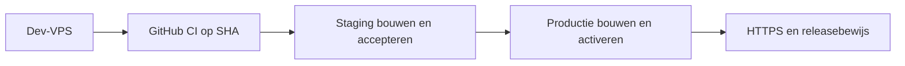

# Staging, productie en uitrol

## 1. Doel en vertrekpunt

DartFlow krijgt een native Next.js-release op de bestaande DG Webservices-infrastructuur. Ontwikkel op de development-VPS. GitHub test de volledige kandidaatcommit. Staging en productie bouwen diezelfde bron-SHA onafhankelijk met hun eigen instellingen, op hun eigen doelrunner. Activeer de release via het bestaande gecontroleerde deploypad, met systemd en Caddy.

De Sites-publicatie van prototype v15 is de referentie voor schermen en gedrag. De native productieapp heeft een eigen bronrepository, databasis en releasegeschiedenis. Leg de koppeling vast tussen prototypecommit `e27cccdbd0b6cd2144cc2f26cab9e2986a903e61` en de nieuwe kandidaatcommit in de applicatierepository.

| Gegeven | Status en herkomst |
|---|---|
| Development-checkout | Eerder opgegeven als `/home/codex/repos/dartflow`. Controleer pad, actuele branch, lokale wijzigingen en de werkelijk ingestelde remote op de development-VPS. |
| Staging | Eerder opgegeven als `https://staging.dartflow.nl` op `dg-nxttrack-01`. Controleer beide aan de hand van de huidige hostinventaris, DNS, GitHub-environment en runnerregistratie. |
| Staging-releasepad en unit | `/srv/sites/dartflow-staging` en `dartflow-staging.service` waren voorgestelde waarden. Gebruik de geregistreerde waarden. |
| Milo op gedeelde host | Eerder opgegeven als `/srv/sites/milobingo-staging`, `milobingo-staging.service`, loopbackpoort `4173` en `https://milo-staging.dgwebservices.nl`. Indien nog op dezelfde host, bewijs vóór en na de DartFlow-release dat Milo ongewijzigd bereikbaar is. |
| Productie | Volgens de opdrachtgever reeds ingericht. Repo, host, origin, runner, poort, unit en projectref verifiëren aan de hand van de bestaande inrichting. Geen production-site-ID of -URL uit staging afleiden. |
| Gedeelde build-lock | De vorige opdracht noemt `/run/lock/dg-build.lock`. Bevestig eigenaar, scope, lockvolgorde, time-out en gedocumenteerde bezet-exitcode van de bestaande wrapper. |

De vorige opdracht **DartFlow-Codex-Staging-Milo-VPS-2026-11-11** beschreef staging. Deze overdracht omvat uitrol naar beide bestaande omgevingen, inclusief productie na geslaagde stagingacceptatie. Houd de bestaande omgevings- en branchbescherming aan. Een release die daar om review vraagt, wacht op die review.

## 2. Verifieer het huidige deploycontract

Lees achtereenvolgens de `AGENTS.md` van de bestaande checkout, `docs/deployment.md`, `ops/deploy-contract.md`, `ops/host-profile.staging.example.json`, de werkelijke GitHub-workflows en het DG-hostprofiel. Vind het productie-equivalent in diezelfde bronnen. Controleer de werkelijke `dg-site-deploy`-implementatie en versie op de bedoelde host of in de bijbehorende infra-repo. Een werkend Milo-voorbeeld is bruikbaar om het gedrag te begrijpen. De wrapper moet de geregistreerde DartFlow-site expliciet kennen.

Vul per omgeving [hostprofiel.template.json](../voorbeelden/deploy/hostprofiel.template.json) in met uitsluitend veilige metadata. Geef niet-bevestigde velden de status Open, met de bron waarin Codex ze kan verifiëren.

| Controlepunt | Bewijs vóór bouwen of wijzigen |
|---|---|
| GitHub | Repo-eigenaar, reponaam, beschermde bronref, vereiste CI-workflow, dispatchcontract, omgeving, deploymentregels en runnerlabels. Controleer dat `staging` en `production` al bestaan, met de bedoelde settings. |
| Doelhost | Stabiele host-ID, Tailscale-naam, hostkey, eigen runner-service, runnernaam, UID en werkpad. Controleer account- en bestandsscheiding tussen staging, productie en siblingprojecten. |
| App-runtime | Exacte appunit, eigen runtimegebruiker, bindadres, unieke vrije loopbackpoort, releasepad, configpad en Node/npm-versie. |
| Webingang | Bestaand Caddy-siteblok, DNS, HTTPS-origin, TLS en huidige health- en readinesspaden. Check upstream en eventuele toegangsrestrictie op staging. |
| Data | Eigen Supabase-projectref, migratiestatus, databaseverbinding, backupdekking en recente herstelproef. Controleer ook of Realtime, opslag en OAuth-callbacks naar de juiste projectomgeving wijzen. |
| Neveneffecten | Resend-configuratie, ontvangergrenzen, Google OAuth-app, Auth-redirects, webhookhost en bestaande workers. Inspecteer status en referenties zonder waarden te tonen. |
| Herstel | Actieve SHA, vorige bekende compatibele SHA, configversies, migratiecompatibiliteit, restorepad, RPO en RTO. |
| Capaciteit | Vrije bytes en inodes voor checkout, install, build, herstelpunt en minimaal actieve plus vorige release. Beschikbaar RAM en buildpiek naast andere projecten. |

Voorbeelden voor inventarisatie op de doelhost, met bekende site-, service- en padwaarden uit het hostprofiel.

```bash
hostnamectl --static
id -un
git branch --show-current
git rev-parse HEAD
git status --short
node --version
npm --version
df -h
df -i
free -h
ss -ltn
systemctl is-active '<dartflow-appunit>'
systemctl show '<dartflow-appunit>' -p User -p Group -p WorkingDirectory -p FragmentPath
stat -c '%U %G %a %n' '<release-root>' '<protected-config-dir>'
readlink -f '<active-release-link>'
```

Verifieer de remote zo nodig met `git remote get-url origin` in de vertrouwde shell. Maak in rapport en logs uitsluitend de geschoonde repo-identiteit zichtbaar. Gebruik gewone OpenSSH over het bestaande Tailscale-beheerpad. Lees van systemd en Caddy alleen de relevante configuratievelden. Gebruik bijvoorbeeld geen `systemctl show -p Environment`, environment-dumps, tokenbevattende Git-URL's of volledige journalexports in overdrachtsbewijs.

## 3. Scheiding per omgeving

| Onderdeel | Staging | Productie |
|---|---|---|
| GitHub | Bestaande environment `staging`, eigen variabelen en dedicated runner. | Bestaande environment `production`, eigen variabelen, bestaande beschermingsregels en dedicated runner. |
| Bron | Volledige 40-teken SHA uit de afgesproken beschermde bronref met groene CI. | Exact de in staging geaccepteerde volledige SHA. |
| Runtime | Eigen site-ID, unit, runtimeaccount, releasepad, loopbackpoort, cache en logstroom. Next.js draait in productiemodus voor representatieve tests. | Eigen site-ID, unit, runtimeaccount, releasepad, loopbackpoort, cache en logstroom. Next.js draait in productiemodus. |
| Backend | Eigen Supabase-project, database, Auth, storage en Realtime. Uitsluitend stagingdata en overeengekomen testidentiteiten. | Eigen Supabase-project, database, Auth, storage en Realtime. Productieaccounts en echte gebruikersdata. |
| OAuth | Eigen Google OAuth-client en consentconfiguratie, staging-projectcallback en eigen appcallback. | Eigen Google OAuth-client en consentconfiguratie, productie-projectcallback en eigen appcallback. |
| Mail | Eigen Resend-sleutel, afzender, webhook en testontvangers. OTP SMTP apart ingesteld op stagingproject. | Eigen Resend-sleutel, geverifieerde afzender, webhook en werkelijke ontvangers. OTP SMTP apart ingesteld op productieproject. |
| URLs en indexering | De staging-origin in app en callbackallowlist. Staging dempen in zoekindex via bestaande toegangscontrole of `noindex`. | Productie-origin in canonical, sitemap, metadata, QR, mail-CTA, OAuth-callbacks en links. Publieke marketing indexeerbaar. Ingelogde en tijdelijke schermen blijven buiten indexering. |

Bewaak de mapping server-side bij startup en bij muterende workflows. Controleer of de Supabase-projectref in build, runtime en migratiedoel klopt. Gebruik op een gedeelde host aparte OS-identiteiten en bewaar staging- en productiecredentials in afzonderlijke toegangsgrenzen. Bij een afwijkende projectref, origin of runner stopt de betreffende job vóór schrijven naar database of activatie.

### Build en runtime

| Instelling | Voorbeeld of bron | Moment |
|---|---|---|
| `NEXT_PUBLIC_SUPABASE_URL` | `https://<project-ref>.supabase.co` van het gecontroleerde doelproject. | Build op de doelrunner. |
| `NEXT_PUBLIC_SUPABASE_PUBLISHABLE_KEY` | Publiceerbare Auth/Data API-sleutel van dezelfde ref. RLS en serverautorisatie blijven van toepassing. | Build op de doelrunner. |
| `DARTFLOW_ENV` | Exact `staging` of `production` in het gevalideerde doelprofiel. | Build indien nodig voor publieke metadata, anders runtime. |
| `DARTFLOW_APP_ORIGIN` | Canonieke HTTPS-origin, zonder query, pad of fragment. | Runtime, en build alleen wanneer pagina's die origin statisch vastleggen. |
| `DARTFLOW_RELEASE_SHA` | Volledige gecontroleerde SHA uit het release-manifest. | Aangeleverd door de gecontroleerde uitrol. |
| `DARTFLOW_DATABASE_URL` | Beschermde app-DB-verbinding wanneer de app rechtstreeks Postgres gebruikt. | Runtime, zonder te printen. Gebruik aparte migratiecredentials. |
| Appgeheimen | Server-side versleutelingssleutel of kluisreferentie, managementcredential voor de providerconfiguratie en alleen noodzakelijke elevated Supabase-credentials. | Afgeschermde runtime; nooit publiek in de build. |
| Resend- en Google-instellingen | Eigen omgevingsrecord uit DartFlow-beheer, write-only secret of sleutelreferentie. Zie de integratiehoofdstukken. | Server-side bij gebruik, onafhankelijk van een applicatiebuild. |

Next.js verwerkt `NEXT_PUBLIC_`-waarden bij `next build`. Promoot daarom **de broncommit** en bouw deze opnieuw in productie met de productieconfiguratie. Kopieer het stagingartefact alleen bij een expliciet gekozen runtime-configuratieontwerp waarvoor dezelfde bytes in beide omgevingen aantoonbaar correct zijn. De DG-baseline is per doelomgeving bouwen. [Next.js Self-Hosting](https://nextjs.org/docs/app/guides/self-hosting)

Gebruik de bestaande lockfile en gepinde Node/npm-versies. Bij `package-lock.json` draait de installatiestap `npm ci`. Verifieer lokaal en op staging welk native artefact de bestaande deploywrapper verwacht. Bij `output: 'standalone'` controleert Codex `server.js` en voegt de buildstap `public/` en `.next/static/` toe aan het artefact wanneer Next.js ze serveert. Test de werkelijke startopdracht en directe requests naar minimaal een fingerprinted JS-bestand, marketingafbeelding en logo. [Next.js output](https://nextjs.org/docs/app/api-reference/config/next-config-js/output)

## 4. Vrijgaveketen



1. **Dev en CI.** Bouw de gehele parity-scope op de development-VPS. Commit op de afgesproken bronref via de bestaande repoafspraken. Draai tests en build in CI op een schone runner. Geef de kandidaat vrij op basis van een geslaagde run van de afgesproken workflow voor die exacte SHA. Een PR-mergecommit, overgeslagen job of groene run op een andere SHA levert geen releasebewijs.
2. **Preflight staging.** Start de bestaande releaseworkflow via haar dispatchcontract met de volledige SHA. Controleer branch ancestry, CI-run, environment, runner, host en het eigen siteprofiel. Jobs met onbetrouwbare PR-code krijgen geen deployrunner of omgevingsgeheimen. Gebruik vaste actieversies en minimale tokenrechten. [GitHub Deployment environments](https://docs.github.com/en/actions/concepts/workflows-and-actions/deployment-environments)
3. **Build en migratie staging.** Neem een site-deploylock en gebruik de bestaande hostbrede build-lock voor de zware build in de vastgelegde volgorde. Controleer ruimte en inodes. Bouw als onprivileged runner vanuit een gecontroleerde snapshot van de SHA. Verifieer buildconfig en manifest. Maak het vereiste herstelpunt en voer idempotente, compatibele migraties uit op de eigen stagingdatabase.
4. **Activatie en acceptatie staging.** Gebruik uitsluitend de gecontroleerde activering voor die site. Verifieer loopback en HTTPS op dezelfde SHA. Voer de geautomatiseerde acceptatie uit op het echte stagingdomein, inclusief de kernflows in het testhoofdstuk. Registreer afzonderlijk welke handmatige tests binnen de afgesproken testscope uitgevoerd zijn. Leg kandidaat-SHA, CI-run, stagingdeploy-run, schema en bewijs vast in een releasebewijs. Produceer pas een acceptatiebewijs nadat het werkelijke deploy- en testpad geslaagd is.
5. **Productie.** Bied de geaccepteerde staging-SHA aan de bestaande productieworkflow aan. Controleer het stagingbewijs en de bestaande productieregels. Bouw op de productierunner met het productieprofiel, bevestig het databaseproject, maak het afgesproken herstelpunt, voer de compatibele migratie uit en activeer uitsluitend de productie-unit.
6. **Productie bevestigen.** Haal de actieve revisie op via de productie-origin en loopback. Controleer health, readiness, route, assets, canonical en correcte backend. Doe waar toegestaan een beperkte productie-smoke met testidentiteiten. Leg de productie-run, werkelijke actieve SHA, migratieversie, datum en tijd en observaties vast. Een build of stagingdeploy alleen voltooit de productie-uitrol niet.

De voorbeelduitwerking [release.yml.example](../voorbeelden/deploy/release.yml.example) laat vaste jobs voor beide GitHub-environments zien, met één kandidaatcommit en bewijs voor promotie. Controleer bij aansluiting op de echte workflows dat de huidige environmentbescherming op de **dispatch-ref** werkt en dat de gecontroleerde kandidaat-SHA die ref daadwerkelijk volgt. [GitHub Deployments and environments](https://docs.github.com/en/actions/reference/workflows-and-actions/deployments-and-environments)

### Locks, herhaalbaarheid en hostgrenzen

- Serialiseer per projectomgeving met de bestaande GitHub-concurrency en een hostlock. Laat een tweede deployment een actieve activatie niet afbreken. De hostbrede build-lock begrenst ook concurrentie met andere sites op die host.
- Volg bij de bekende lockbezetting uitsluitend het bestaande retrybeleid, met bounded backoff en herkenbare exitcode. Meld build-, migratie- en runtimefouten direct met geschoonde diagnostiek. Herhaal een volledige migratie- of activatieketen alleen wanneer het huidige release- en schemaresultaat dat veilig toestaat.
- De root-owned wrapper controleert site-ID, bron, SHA, run-ID en paden. Laat privileged acties geen beschrijfbare runnerworkspace, symbolische links naar willekeurige locaties of ongevalideerde parameters vertrouwen. Gebruik de werkelijk aanwezige wrapper en zijn beperkte bevoegdheden. De workflow voert builds en packagescripts onder de runnergebruiker uit.
- Wijzig uitsluitend de geregistreerde DartFlow-omgeving. Controleer bij een gedeelde host de bestaande Milo-unit, eigen loopbackpoort en bereikbaarheid vóór en na. Laat andere units, domeinen, gebruikers, firewalls en runnerregistraties intact.

## 5. Activatie en terugzetten

Werk met een onveranderlijke kandidaatdirectory per SHA en run-ID en een gecontroleerde verwijzing naar de actieve release. Houd release-, runtimeconfig- en schemaspecificaties samen in het manifest. Een voorbeeld van het uitvoercontract staat in [dartflow.service.example](../voorbeelden/deploy/dartflow.service.example) en [Caddyfile.example](../voorbeelden/deploy/Caddyfile.example). Gebruik de bestaande units en Caddy-mapping wanneer die al correct zijn.

| Fase | Gedrag |
|---|---|
| Voor activatie | Houd actieve code, config en vorige compatibele release beschikbaar. Controleer artefacthash, startbestand, migratieversie, databaseproject, vrije ruimte en rollbackcompatibiliteit. |
| Migratie | Registreer migratie-ID en herstelreferentie. Pas een uitbreidende migratie toe die ook met de actieve/vorige versie werkt, of volg het afgesproken releaseplan voor een migratie die dat aantoonbaar vereist. Stop voor activatie bij migratiefout. |
| Activatie | Wissel de actieve verwijzing atomair volgens het DG-contract, start de eigen appunit en controleer de release-ID. Valideer en herlaad Caddy alleen als de eigen siteconfig is gewijzigd. Een atomaire linkwissel garandeert op zichzelf geen ononderbroken HTTP-service bij een systemd-restart. |
| Ongezonde kandidaat | Zet met de wrapper de vorige compatibele release én bijpassende config terug. Herhaal loopback, HTTPS, readiness en een gebruikersflow. Sla oorzaak, oorspronkelijke SHA, herstelde SHA en eventuele nieuwe migratiestatus op. |
| Dataherstel | Behandel als afzonderlijke operatie met vastgesteld verliesvenster en geteste restore. Herstel eerst in isolatie. Een standaard approllback draait geen productiedatabase, sessies, Google-configuratie of eerder verstuurde e-mail terug. |

Koppel zware controle, migratie en activatie aan de locks zoals in het actuele DG-contract. Voor vertrouwde productie-uitrol is een eerdere hersteltest op staging een concreet bewijs. Gebruik back-ups die bij het juiste project en tijdstip passen. Kijk bij productiestoringen eerst of een compatibele approllback of voorwaartse fix veilig herstel geeft.

## 6. Gezondheids- en smokechecks

Leg het contract vast voor `GET /api/health` (proces en revisie) en `GET /api/ready` (bruikbare dataverbinding en compatibel schema). Gebruik bij onbekende status een foutcode en geschoonde response. Geef de verwachte omgeving en volledige release-SHA uit het gevalideerde manifest door, met `Cache-Control: no-store`. Voorbeeldrespons.

```json
{
  "status": "ok",
  "environment": "production",
  "release": "aaaaaaaaaaaaaaaaaaaaaaaaaaaaaaaaaaaaaaaa"
}
```

Geef bij readinessproblemen HTTP 503 terug zonder DB-foutdetails of projectcredentials. Maak relevante healthmetrics beschikbaar in het bestaande DG-overzicht. Voorbeeld van bewijsverificatie met [check-release.sh](../voorbeelden/deploy/check-release.sh). Loopbackcheck draait op de doelhost. Controleer de externe URL ook vanaf een onafhankelijke plek wanneer de bestaande toegangsregeling dat toestaat.

| Controle | Bewijs |
|---|---|
| Correcte release | Loopback en publiek HTTPS leveren op beide checks `environment` en `release` gelijk aan de doelwaarden. Actieve release en systemd-unit wijzen naar diezelfde kandidaat. |
| DNS, TLS, routing | Juist domein, geldig certificaat, verwachte Caddy-upstream en correcte HTTPS-redirects. De apppoort is extern niet direct bereikbaar. |
| Navigatie en assets | Marketinghome, app, oude deep links, Sprint-wachtscherm en QR openen. Statische assets komen zonder 404. Canonical wijst naar de productie-origin. |
| Authenticatie en grenzen | Inloggen, uitloggen, callback en gebruikersscope werken op de juiste Auth-omgeving. Stagingaccount kan geen productiedata lezen. Adminroutes eisen de juiste platformrol. |
| Scoring en toernooi | Een stagingtest voltooit Sprint met twee spelers, scoreoverdracht, uitslag, baanvrijgave en automatische vervolgtoewijzing. Productiesmoke past in de bestaande testscope en raakt geen echte wedstrijd. |
| Mail | Stagingmail naar een toegestane testontvanger en gecontroleerde webhooks. Bij productie de eigen afzender en status controleren binnen afgesproken testscope. OTP SMTP en appmail afzonderlijk verifiëren. |
| Herstel en monitoring | Bewijs van testrestore, bekende vorige compatibele release, release-/service-/backupstatus en melding bij mislukte readiness. |

## 7. Opleverbewijs

Bewaar één ingevuld [releasebewijs.template.md](../voorbeelden/deploy/releasebewijs.template.md) met links naar de werkelijke CI-, staging- en productieruns en de officiële domeinen. Noteer het onderscheid tussen build-SHA, actieve SHA, migratieniveau en ingeschakelde integraties. Rapporteer **Pass**, **Fail**, **Open** of **N.v.t.** per check. Bij een ontbrekend runtimegeheim, toegangsrecht of niet-identificeerbaar target hoort een gerichte blocker met beschikbare bewijsstukken. Claim productie alleen wanneer de productie-origin de bedoelde revisie teruggeeft.

## Bronnen

- DG Webservices VPS Standaard v1 van 4 november 2026 en de bestaande DartFlow-deployopdracht van 11 november 2026. De actuele contracten op de development-VPS en doelhosts bepalen waarden en wrappercommando's.
- [GitHub Actions Deployment environments](https://docs.github.com/en/actions/concepts/workflows-and-actions/deployment-environments)
- [GitHub Actions REST API voor workflow-runs](https://docs.github.com/en/rest/actions/workflow-runs)
- [Next.js Self-Hosting](https://nextjs.org/docs/app/guides/self-hosting)
- [Next.js standalone-uitvoer](https://nextjs.org/docs/app/api-reference/config/next-config-js/output)
- [Caddy gecontroleerd herladen](https://caddyserver.com/docs/getting-started)
